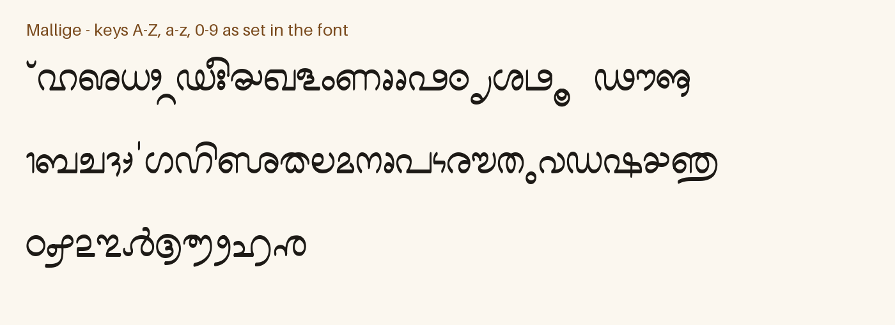

<h1 align="center">Mallige</h1>
<p align="center"><em>The largest font in the family, with Unicode Tulu-Tigalari support.</em></p>



Mallige is the most complete font in the family, with far more glyphs than the others. Besides the key-mapped glyphs it covers 80 code points in the Unicode **Tulu-Tigalari** block (U+11380 to U+113FF), so part of its text can be stored as real Unicode.

| | |
|---|---|
| **Designer** | Prahlad Prasad Tantry |
| **Format** | TrueType, `.ttf` |
| **Glyphs** | 1,791 |
| **Year** | 2022 |
| **License** | [SIL OFL 1.1](OFL.txt) |
| **Family** | [Tantry Tulu Font Foundry](https://github.com/TantryTuluFonts) |

## Get the font

Download the latest build from the [Releases page](https://github.com/TantryTuluFonts/mallige/releases/latest), or take `fonts/XmlAlieg(mallige)v1.4.ttf` straight from this repository.

- **Windows:** right-click the file and choose *Install for all users*.
- **macOS:** open the file and click *Install Font*.
- **Linux:** copy it to `~/.local/share/fonts/` and run `fc-cache -f`.

## How to type with Mallige

Mallige is key-mapped: it places Tulu lipi glyphs on the Latin keys, so you type with an ordinary keyboard and the font draws the Tulu forms. The specimen above shows what each key produces. Because the text is stored as Latin characters, it only reads as Tulu while Mallige is applied; paste it somewhere with a different font and it will show as plain Latin letters. Keep that in mind for search, sharing and archiving.

Mallige follows the **AccTantra** typing standard, the shared key map for all the ASCII fonts in the Tantry family. See the [key map](https://github.com/TantryTuluFonts/AccTantra/blob/main/docs/KEYMAP.md), the [conjunct reference](https://github.com/TantryTuluFonts/AccTantra/blob/main/docs/CONJUNCTS.md) and the [typing examples](https://github.com/TantryTuluFonts/AccTantra/blob/main/docs/EXAMPLES.md). Try it: type `EAamA nEma narayNay` and Mallige shows *Om namo Narayanaya*.

**Need real Unicode text?** [Mallige_unicode](https://github.com/TantryTuluFonts/Mallige_unicode) is a Unicode font for the Tulu-Tigalari script, and the [AccTantra_Unicode](https://github.com/TantryTuluFonts/AccTantra_Unicode) keyboard types it using the same logic.

**Unicode part:** characters in the Tulu-Tigalari block are encoded as standard Unicode, so they keep their meaning when copied, searched or shown in another Unicode-aware font. The key-mapped part works like the other fonts in the family.

## Use on the web

```css
@font-face {
  font-family: "Mallige";
  src: url("fonts/XmlAlieg(mallige)v1.4.ttf");
  font-display: swap;
}
.tulu { font-family: "Mallige", sans-serif; }
```

## License and credit

Mallige is free software under the [SIL Open Font License 1.1](OFL.txt): use it in print, on screens or in products, study it, and make your own versions, as long as the font is not sold on its own and derivatives stay under the same license. Please keep the credit **Prahlad Prasad Tantry** when you share it. Full history is in the [FONTLOG](FONTLOG.md).

Questions or specimens to show off? [Open an issue](https://github.com/TantryTuluFonts/mallige/issues).
